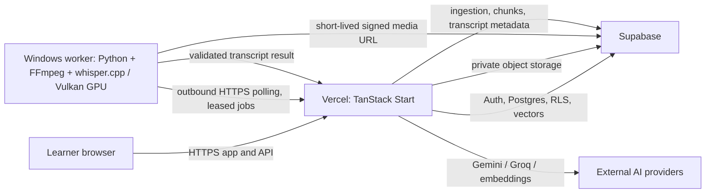
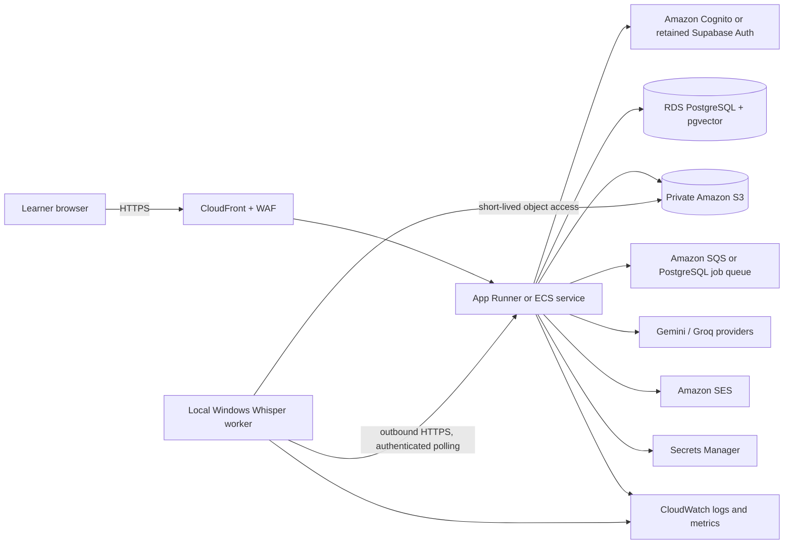

# Horizon 2.0 architecture and AWS migration guide

This document separates the current as-built system from a future AWS target. AWS is a reference architecture only; the deployed app remains on Vercel with Supabase.

## As built

The browser talks to Horizon's server routes and the browser Supabase client. Personal records use owner-scoped RLS. The worker uses an outbound HTTPS connection, a worker bearer token and per-job lease token; it does not need inbound router forwarding. Transcription jobs are stored in Supabase and media stays in private storage. Gemini/Groq keys and the service role belong only in server/worker configuration.

## AWS reference target

## Service mapping

| Current capability | AWS-aligned option | Migration notes |
|---|---|---|
| Vercel web/API runtime | App Runner or ECS/Fargate | Validate TanStack server runtime, streaming, route behavior and scale-to-zero/cost before choosing. |
| Supabase PostgreSQL + pgvector | RDS for PostgreSQL with pgvector | Port migrations, extensions, RLS policies and auth identity mapping; verify vector index compatibility and backups. |
| Supabase Auth | Cognito, or retain Supabase Auth initially | Identity migration requires password reset or supported secure migration; do not copy password hashes casually. |
| Supabase private Storage | S3 private buckets | Preserve object ownership/path mapping and use short-lived presigned URLs. |
| Database-backed worker jobs | PostgreSQL queue or SQS | Keep atomic claims, leases, retries, idempotency and per-user ownership semantics. |
| Local Whisper on Windows GPU | Remains current host; future GPU EC2/ECS only after evaluation | No AWS inference service is provisioned by this project. |
| Auth email | SES | Requires verified sender/domain, DKIM/SPF/DMARC and production access. |
| Runtime secrets | AWS Secrets Manager | Separate app, worker and deployment scopes; rotate values and never expose in client bundles. |
| Logs/health | CloudWatch | Add redaction, retention, worker heartbeat and queue-age alarms. |

## Migration sequence

1. Inventory current tables, extensions, policies, storage buckets, object keys, auth redirects, environment names, traffic and AI-provider dependencies.
2. Provision a non-production AWS environment only after budget/credentials approval. Enable encrypted managed database backups and object versioning/lifecycle rules.
3. Port and compare schema, constraints, indexes, triggers and RLS behavior. Run cross-account tests before moving learner data.
4. Migrate storage with checksums and metadata manifests; verify private access and short-lived downloads.
5. Deploy app and worker with scoped secrets; test signup, recovery, uploads, transcription, RAG and rollback in staging.
6. Schedule a controlled data freeze, export/import, record counts, checksums and smoke tests; retain a rollback path before DNS cutover.

## Configuration and cost

Use the project `.env.example`, `worker/.env.example`, [local setup](LOCAL_SETUP.md), and [worker setup](WHISPER_WORKER.md) as the configuration inventory. Never place secrets in the browser or source control. Costs are **not estimated here** because region, traffic, instance class, storage, retention and provider usage are unspecified. Obtain current AWS quotes before any provisioned migration; this document does not authorize paid infrastructure.
